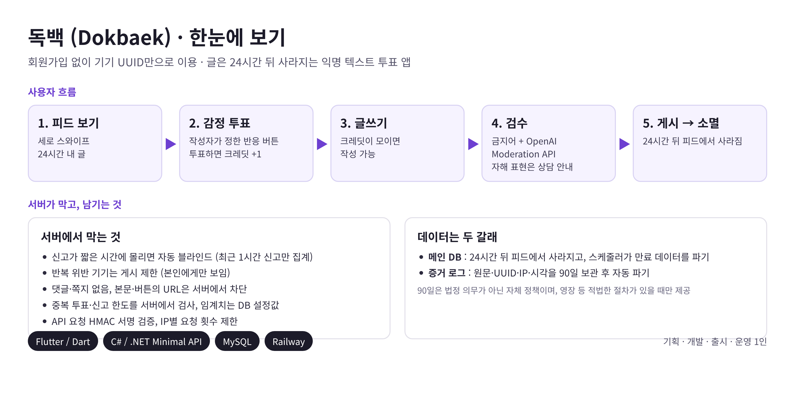
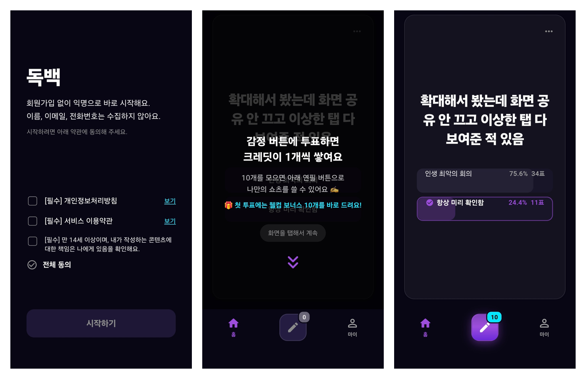

# 독백 (Dokbaek)

**24시간 뒤 사라지는 익명 텍스트 투표 앱.** 기획부터 개발, 출시, 운영까지 혼자 진행했습니다.

[Google Play에서 보기](https://play.google.com/store/apps/details?id=com.anonymous.shorts) · [설계 기록(ADR)](https://shining-juice-96b.notion.site/38acbc2f0ed480cfb450cdf37022ad15?v=38acbc2f0ed4806a96e5000c0540e2d7) · [처리방침·약관](https://github.com/simfull421/anonymous-shorts-privacy)

| | |
|---|---|
| 기간 | 2026.06.25 ~ (2026.08.04 프로덕션 출시, 유지보수 중) |
| 일정 | 계획 약 12주(06.25~09.21, 간트 기준) → 실제 약 6주 만에 출시(비공개 테스트 2주 포함) |
| 스택 | Flutter/Dart · C#/.NET Minimal API · MySQL · Railway |
| 역할 | 기획, 설계, 클라이언트, 서버, QA, 법령 질의까지 1인 |
| 검증 | 테스트케이스 64개를 실기기(ADB)에서 직접 수행하고 결과와 비고를 기록 |

---

## 핵심 사례: 법적 근거를 추측하지 않고 확인하기

**1. 상황**
가입이 없고, 글이 24시간 뒤 사라지고, 자동 제재가 걸리는 구조라서 인터넷 템플릿의 개인정보처리방침·약관은 맞지 않았습니다. 그래서 코드가 실제로 무엇을 저장하고 언제 지우는지부터 확인해 직접 작성했습니다.

**2. 문제**
작성하면서 판단이 서지 않는 질문 네 개가 남았습니다.
해외 서버(Railway)가 국외이전인지, 분쟁·수사 대응용 IP를 어디까지 보관해도 되는지, 자동 게시 제한을 알리지 않아도 되는지, 익명 서비스에서 만 14세 확인은 어디까지 해야 하는지입니다.
출시 후 이 내용을 반영하다가 코드 주석과 이용자에게 나가는 삭제 안내 메시지에 "ArchiveLog는 법적 의무에 따라 90일 보관"이라고 적혀 있는 것을 발견했습니다. 그런 보관 의무를 정한 법은 없었습니다. 확인 없이 쓴 문장이 이용자에게 그대로 나가고 있었습니다.

**3. 판단**
모르는 채로 운영하지 않기로 했습니다. 118에 전화해 국민신문고로 질의할 수 있다는 것을 알게 됐고, 개인정보보호위원회와 공정거래위원회에 질의했습니다(2026.07.21, 후속 07.28). 회신은 법적 판단이 아닌 일반 해석이라는 전제가 붙어 있어서, 확인된 것과 확인되지 않은 것을 나눠 반영하기로 했습니다.

**4. 행동**
- 코드 주석과 삭제 안내 메시지에서 "법적 의무" 문구를 고치고, 처리방침에 90일이 자체 정책임을 명시했습니다. 90일을 정한 이유(통신비밀보호법 시행령의 인터넷 로그 3개월 기준 참고)와 영장 등 적법한 절차가 있을 때만 제공한다는 점을 함께 적었습니다.
- 국외이전은 호스팅, 콘텐츠 검수, 이메일 3건을 표로 공개했습니다.
- 자동화된 결정은 기준과 절차를 공개하는 조항을 신설했습니다. 신고 임계치 숫자는 악용될 수 있어 비공개로 정하고, 비공개 이유를 문서에 적었습니다.
- 만 14세 확인은 동의 화면에 확인 체크를 두고, 회신에서 합리적 장치의 예로 든 "사용자 간 신고"를 앱 신고 항목에 추가했습니다.

**5. 결과와 남은 것**

| 회신으로 확인된 것 | 확인받지 못한 것 |
|---|---|
| 보호법에 보유기간 규정은 없고, 목적과 기간을 정해 고지하면 그 기간 동안 보유할 수 있다 | 90일이 필요 최소 기간인지는 운영자가 입증해야 한다 |
| 국외이전은 계약 이행을 위한 처리위탁·보관에 해당하면 처리방침 공개로 가능하다 | 사실관계가 불명확해 명확한 답변은 어렵다는 회신(변호사 자문 참고) |
| 자동화된 결정은 기준과 절차를 공개해야 한다 | 수치 공개 여부는 운영자가 판단할 사항 |
| 14세 연령 확인은 합리적 장치를 마련하는 것이 바람직하다 | 약관의 적법성(공정위는 사업자 본인 약관의 유권해석을 하지 않음) |

**배운 점.** 확인되지 않은 것은 확인되지 않았다고 남기고, 판단의 근거를 문서로 남겨야 같은 문제가 반복되지 않습니다. 출시 후에는 광고 자리를 채워 둔 더미 데이터가 실제 이용자에게 스폰서 콘텐츠처럼 노출되고 있는 것도 발견해 제거했습니다.

---

## 그 밖의 설계 판단

| 문제 | 선택 | 감수한 것 |
|---|---|---|
| 읽기만 하고 쓰지 않는 이용자 | 남의 글에 투표해야 크레딧이 쌓이고, 크레딧으로 글을 쓴다. 보유 상한을 둠 | 크레딧을 위한 투표가 섞여 결과에 노이즈가 생김 |
| 신고를 몰아 멀쩡한 글을 내리는 행위 | 중복 신고 불가, 시간당 신고 한도, 최근 1시간 신고만 집계. 앱뿐 아니라 서버에서도 검사하고 임계치는 DB 설정값으로 둠 | 앱 재설치로 UUID가 초기화되면 한도를 우회할 수 있음. 대신 크레딧과 글이 사라져 비용이 큼 |
| 글을 통한 범죄 악용 | 댓글·쪽지 없음, 반응은 작성자가 정한 버튼만, 본문·버튼 URL을 서버에서 차단, 24시간 소멸, 증거 로그 90일 | 본문에 시간·장소만 적는 일방 게시는 막지 못함. 사후 대응으로 다룸 |
| 유해 표현 필터 | 금지어 DB는 우회 표현을 따라갈 수 없어 포기. 최소 리스트 + OpenAI Moderation. 자해 표현은 차단 대신 상담 안내 | 호출량은 별도 장치 없이 "글쓰기에 크레딧이 필요하다"는 규칙에 묶임 |
| 기기 무결성 검사(Play Integrity) | 도입하지 않음. 얻는 것이 크레딧 소량인 반면 멀쩡한 사용자가 걸릴 위험이 큼. 대신 HMAC 서명과 IP 요청 제한 | 실제로 문제가 생기면 그때 도입 |

**기술 메모.** 피드 정렬은 누적 투표수 대신 시간 감가상각(`투표수 / (경과시간 + 2)^1.5`)으로 신규 글의 노출을 보장했습니다. 투표 버튼은 JOIN을 피하려고 JSON 컬럼으로 역정규화했고, 신고는 UPDATE/DELETE 대신 로그를 쌓고 최근 1시간만 조회합니다.
