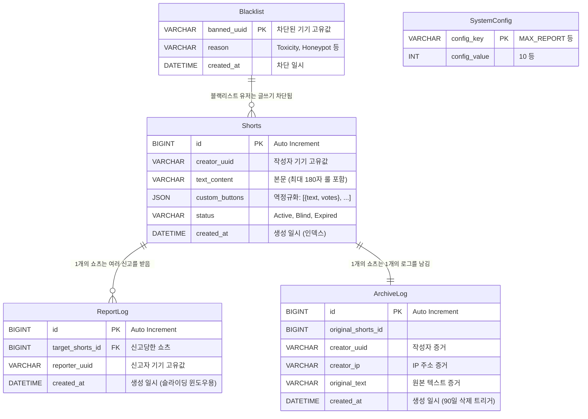

# [SAD] 데이터 모델링 및 DB 설계 명세서

1. BCE (Boundary-Control-Entity) 분해 다이어그램
    
    ```mermaid
    flowchart LR
      %% 1. Boundary Layer (사용자 접점 / UI)
      subgraph Boundary["Boundary Layer - Client UI"]
        direction TB
        B_Feed["FeedView UI"]
        B_Write["WritePage UI"]
        B_Report["ReportButton UI"]
        B_Vote["VoteButton UI"]
      end
    
      %% 2. Control Layer (비즈니스 로직 / API)
      subgraph Control["Control Layer - API & Logic"]
        direction TB
        C_FeedProc["Feed Controller"]
        C_Sanction["Sanction Engine"]
        C_VoteMgr["Vote Manager"]
      end
    
      %% 3. Entity Layer (데이터 구조 / DB)
      subgraph Entity["Entity Layer - Data Structure"]
        direction TB
        E_Shorts[("Shorts")]
        E_Log[("Archive Log")]
        E_Blacklist[("Blacklist")]
        E_ReportLog[("Report Log")]
      end
    
      %% Flow Connections
      B_Write -->|"업로드 요청"| C_FeedProc
      B_Feed -->|"피드 조회"| C_FeedProc
      B_Vote -->|"감정 투표"| C_VoteMgr
      B_Report -->|"신고 누적"| C_Sanction
    
      C_VoteMgr -.->|"독성 임계치 초과"| C_Sanction
    
      C_FeedProc -->|"24h 데이터 생성"| E_Shorts
      C_FeedProc -->|"증거 원본 백업"| E_Log
      C_VoteMgr -->|"투표수 업데이트"| E_Shorts
    
      C_Sanction -->|"슬라이딩 윈도우 검증"| E_ReportLog
      C_Sanction -->|"상태 강제 변경 - Blind"| E_Shorts
      C_Sanction -->|"어뷰저 영구 격리"| E_Blacklist
    ```
    

💡 **BCE 다이어그램 채택 및 엔티티 식별 근거**

배운 대로, DB 엔티티를 누락 없이 식별하기 위해 BCE를 그렸다.
논리적 흐름을 텍스트로 표현하여 활동 다이어그램같이 한눈에 알아보기 쉽도록 했다. 

1. ERD (Entity Relationship Diagram)



**💡 아키텍처 결정 사유: 역정규화 (Denormalization)**

처음에는 배운 대로 제1정규화(1NF)를 준수하려 했다. 

하지만 24시간 서버를 가동하며 쇼츠를 보는 유저들에게 성능을 보장하는 것도 중요하기에, 
이 딜레마를 역정규화로 해결하기로 했다. 

알아보니, 정규화를 지키기 위해 피드를 넘길 때마다 DB JOIN 연산을 걸어 성능을 깎아먹는 것보다, 
JSON 칼럼 하나에 데이터를 몰아넣게 되면, 일일히 JOIN 하지 않고도 읽기 속도를 끌어올리는 것이 
가능했기에, 이 서비스의 목적에 더 맞는 실무적인 선택이라고 판단했다. 

1. 릴레이션 스키마 

| 테이블 | 컬럼(스키마) | PK | FK | 타입/특이사항(비고) | 인덱스/운영 포인트 |
| --- | --- | --- | --- | --- | --- |
| **Shorts** | `id`, `creator_uuid`, `text_content`, `custom_buttons`, `status`, `created_at` | `id` | - | `custom_buttons`: **JSON**(역정규화: `[{text, votes}, ...]`) | `created_at` 인덱스(24h 만료/조회 최적화) |
| **ArchiveLog** | `id`, `original_shorts_id`, `creator_uuid`, `creator_ip`, `original_text`, `created_at` | `id` | (필요 시) `original_shorts_id → Shorts.id` | 90일 보관용 증거 로그. **Append-only**(UPDATE 없음) | TTL/삭제 트리거(90일) 전제, 쓰기 위주 |
| **ReportLog** | `id`, `target_shorts_id`, `reporter_uuid`, `created_at` | `id` | `target_shorts_id → Shorts.id` | 슬라이딩 윈도우 기반 신고 트랜잭션 테이블 | 1시간 내 신고횟수 `SELECT COUNT` 최적화(보통 `target_shorts_id`, `created_at` 인덱스 고려) |
| **Blacklist** | `banned_uuid`, `reason`, `created_at` | `banned_uuid` | - | `banned_uuid` 자체를 PK로 사용(중복 차단 방지, 빠른 조회) | PK 인덱스로 조회 보장 |
| **SystemConfig** | `config_key`, `config_value` | `config_key` | - | 런타임 임계치(MAX_REPORT 등) 조절용 설정 테이블 | 키 기반 단건 조회/갱신 용도 |

**💡 아키텍처 결정 사유: 슬라이딩 윈도우 & GC 방어**

ReportLog는 1시간 단위 스케줄러 초기화 대신 슬라이딩 윈도우 방식을 채택했다.

처음엔 1시간마다 DB 스케줄러로 신고 횟수를 초기화하려고 했다. 

하지만, 실시간 서버에서 이렇게 대규모 UPDATE/DELETE가 발생하면 성능이 느려질 것 같기에

생각해보니, 데이터를 지우는 건 db에선 이쁘게 보이겠지만,
신고할 때 로그만 남기고 최근 1시간 치만 `SELECT COUNT`로 조회하는 방식이
굳이 업데이트 및 삭제를 하지 않아도, 서버 부담을 막는 해결책인 것을 알았다.

1. 시스템 초기 데이터 

**SystemConfig 테이블 초기 설정값 (런타임 제어용)**

1. 시스템 초기 데이터
- `BLIND_REPORT_THRESHOLD` = **10** (쇼츠 자동 블라인드 처리를 위한 누적 신고 임계치)
- `HOURLY_REPORT_LIMIT` = **5** (슬라이딩 윈도우 기반 시간당 최대 신고 허용 횟수)
- `WRITE_CREDIT_COST` = **10** (쇼츠 1회 작성 시 소모되는 크레딧)
- *(※ 로고 5회 터치 등 보안 진입점은 클라이언트 코드 내부에 은닉함)*

5. 물리 DDL 스크립트

```sql
-- 1. 시스템 설정 테이블 (심사관 비밀코드 추가)
CREATE TABLE `SystemConfig` (
    `config_key` VARCHAR(50) NOT NULL,
    `config_value` INT NULL,
    `config_string` VARCHAR(255) NULL, -- 문자열 설정을 위한 칼럼 추가
    `description` VARCHAR(255) NULL,
    PRIMARY KEY (`config_key`)
) ENGINE=InnoDB DEFAULT CHARSET=utf8mb4 COLLATE=utf8mb4_unicode_ci;

-- 초기 정책 데이터 삽입
INSERT INTO `SystemConfig` (`config_key`, `config_value`, `config_string`, `description`) VALUES
('BLIND_REPORT_THRESHOLD', 10, NULL, '자동 블라인드 누적 신고 임계치'),
('HOURLY_REPORT_LIMIT', 5, NULL, '유저별 1시간 내 최대 신고 가능 횟수'),
('WRITE_CREDIT_COST', 10, NULL, '쇼츠 작성 시 소모되는 크레딧'),
('REVIEWER_SECRET_CODE', NULL, 'AppleReview2026!', '스토어 심사관 샌드박스 진입용 시크릿 코드');

-- 2. 블랙리스트 기기 테이블
CREATE TABLE `Blacklist` (
    `banned_uuid` VARCHAR(64) NOT NULL,
    `reason` VARCHAR(100) NOT NULL,
    `created_at` DATETIME NOT NULL DEFAULT CURRENT_TIMESTAMP,
    PRIMARY KEY (`banned_uuid`)
) ENGINE=InnoDB DEFAULT CHARSET=utf8mb4 COLLATE=utf8mb4_unicode_ci;

-- 3. 익명 유저 지갑 및 권한 테이블 (역정규화: Shorts와 JOIN 안 하고 작성 권한만 검증)
CREATE TABLE `UserWallet` (
    `uuid` VARCHAR(64) NOT NULL,
    `credit_balance` INT NOT NULL DEFAULT 0,
    `role` ENUM('User', 'Reviewer', 'Admin') NOT NULL DEFAULT 'User',
    `created_at` DATETIME NOT NULL DEFAULT CURRENT_TIMESTAMP,
    PRIMARY KEY (`uuid`)
) ENGINE=InnoDB DEFAULT CHARSET=utf8mb4 COLLATE=utf8mb4_unicode_ci;

-- 4. 초고휘발성 쇼츠 메인 테이블 (total_votes, language_code 반영 완료)
CREATE TABLE `Shorts` (
    `id` BIGINT NOT NULL AUTO_INCREMENT,
    `creator_uuid` VARCHAR(64) NOT NULL,
    `language_code` VARCHAR(10) NOT NULL DEFAULT 'ko',
    `text_content` VARCHAR(200) NOT NULL,
    `custom_buttons` JSON NOT NULL,
    `total_votes` INT NOT NULL DEFAULT 0 COMMENT '랭킹 계산용 총 투표수 역정규화 캐싱',
    `bgm_id` VARCHAR(50) NULL,
    `status` ENUM('Active', 'Blind', 'Expired') NOT NULL DEFAULT 'Active',
    `created_at` DATETIME NOT NULL DEFAULT CURRENT_TIMESTAMP,
    PRIMARY KEY (`id`),
    INDEX `idx_shorts_created_at` (`created_at`), 
    INDEX `idx_shorts_creator_uuid` (`creator_uuid`),
    INDEX `idx_shorts_language` (`language_code`, `created_at`)
) ENGINE=InnoDB DEFAULT CHARSET=utf8mb4 COLLATE=utf8mb4_unicode_ci;

-- 5. 90일 법적 증거 보관 로그 테이블
CREATE TABLE `ArchiveLog` (
    `id` BIGINT NOT NULL AUTO_INCREMENT,
    `original_shorts_id` BIGINT NOT NULL,
    `creator_uuid` VARCHAR(64) NOT NULL,
    `creator_ip` VARCHAR(45) NOT NULL,
    `original_text` TEXT NOT NULL,
    `created_at` DATETIME NOT NULL DEFAULT CURRENT_TIMESTAMP,
    PRIMARY KEY (`id`),
    INDEX `idx_archive_created_at` (`created_at`) 
) ENGINE=InnoDB DEFAULT CHARSET=utf8mb4 COLLATE=utf8mb4_unicode_ci;

-- 6. 슬라이딩 윈도우 검증용 실시간 신고 로그 테이블
CREATE TABLE `ReportLog` (
    `id` BIGINT NOT NULL AUTO_INCREMENT,
    `target_shorts_id` BIGINT NOT NULL,
    `reporter_uuid` VARCHAR(64) NOT NULL,
    `created_at` DATETIME NOT NULL DEFAULT CURRENT_TIMESTAMP,
    PRIMARY KEY (`id`),
    INDEX `idx_report_validation` (`reporter_uuid`, `created_at`) 
) ENGINE=InnoDB DEFAULT CHARSET=utf8mb4 COLLATE=utf8mb4_unicode_ci;
```