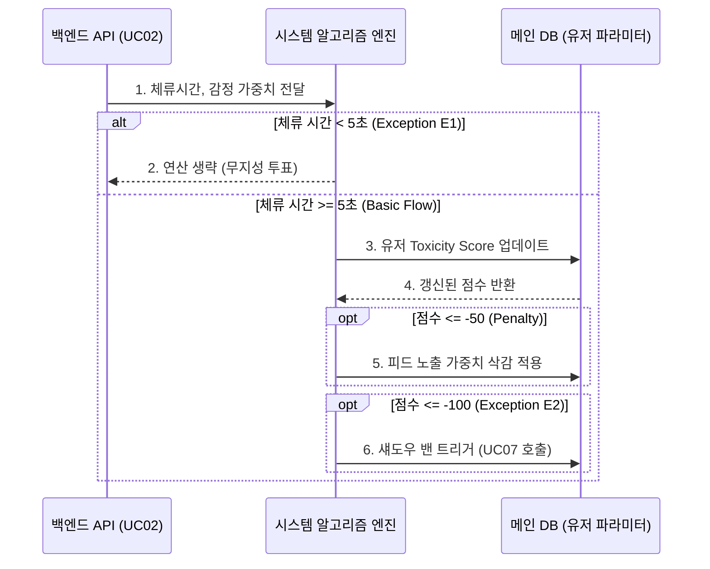

# 액터 및 유스케이스 정의

## 👥 액터(Actor) 정의

- **일반 유저 (User):** 앱을 실행하여 쇼츠를 소비(조회)하고 감정을 투표하는 주체.
- **창작자 (Creator):** 일정 투표 자격을 갖추고 텍스트 쇼츠를 작성하는 주체 (일반 유저와 동일).
- **시스템 (System):** 시간, 알고리즘, 룰에 따라 백그라운드에서 데이터를 처리하는 무인 자동화 시스템.
- **관리자 (Admin):** 수사기관 영장 집행 시 로그를 추출하거나, 법적 문제 발생 시 DB에서 직접 데이터를 제어하는 운영 주체 (앱 내 UI 개입 X).

## ⚙️ 기능별 유스케이스(Use Case) 명세

- UC01: 피드 스와이프 및 조회 (View Shorts)
    - **유스케이스 ID:** UC01
    - **액터:** 일반 유저 (외부 주체)
    - **사전 조건:** 기기가 네트워크에 정상 연결되어 있으며 앱이 실행된 상태여야 한다.
    
    **🔄 기본 흐름 (Basic Flow)**
    
    1. 유저가 앱을 실행하거나 피드 탭에 진입한다.
    2. 클라이언트 앱은 기기에 저장된 유저의 '독성 수치'를 헤더에 담아 백엔드 API에 최초 피드를 요청한다.
    3. 백엔드 API는 메인 DB에서 등록된 지 1시간 이내의 쇼츠 중 알고리즘에 맞는 데이터를 필터링하여 클라이언트로 반환한다.
    4. 클라이언트 앱은 첫 번째 쇼츠를 화면에 렌더링하여 유저에게 노출한다.
    5. 유저가 화면을 위로 스와이프(Swipe)한다.
    6. 클라이언트 앱은 다음 쇼츠를 렌더링하며, 지나친 이전 쇼츠는 로컬 메모리에서 즉시 파기한다.
    
    **🔀 대안 흐름 (Alternative Flow)**
    
    - **4a. 무한 스크롤 프리페치(Pre-fetch):** 유저가 탐색을 지속하여 클라이언트에 남은 쇼츠가 3개 이하가 될 경우, 앱은 백그라운드에서 다음 피드를 미리 요청하여 로딩 지연을 방지한다.
    - **4b. 다국어 격리 및 랭킹 알고리즘 적용 (Language & Time Decay):** 서버는 요청자의 기기 언어 코드(`language_code`)와 일치하는 쇼츠만 `SELECT` 하며, 시간 감가상각 공식에 따라 랭킹 점수(가중치)가 높은 순으로 정렬하여 클라이언트에게 반환한다.
    
    **⚠️ 예외 흐름 (Exception Flow)**
    
    - **E1. 피드 데이터 고갈:** 1시간 내 업로드된 데이터가 0개일 경우, 앱은 데이터 없음(Empty State) 안내 화면을 노출하고 10초 주기 자동 재요청을 수행한다.
    - **E2. 네트워크 단절:** 통신 도중 인터넷 연결이 해제되면 스와이프 동작을 잠금 처리하고 연결 안내 토스트 팝업을 출력한다.
    - **E3. 스와이프 시점 수명 만료:** 로딩된 쇼츠로 스와이프하는 찰나에 해당 데이터의 1시간 수명(TTL)이 만료된 경우, 앱은 해당 콘텐츠 노출을 취소(Drop)하고 다음 순번의 쇼츠를 즉시 호출한다.
    - **제약 사항:** 검색 기능 지원 불가, 이전 쇼츠로 되돌아가기 기능 제공 불가.
- UC02: 감정 투표 (React to Shorts)
    
    ### 2. UC02: 감정 투표 (실전 분해 명세서)
    
    - **유스케이스 ID:** UC02
    - **유스케이스 명:** 커스텀 반응 투표 및 크레딧 획득
    - **액터:** 일반 유저 (외부 주체)
    - **사전 조건:** 유저가 UC01을 통해 특정 쇼츠와 그에 종속된 커스텀 반응 버튼(2~4개)을 화면에 렌더링한 상태여야 한다.
    
    **🔄 기본 흐름 (Basic Flow)**
    
    1. **[유저]** 화면에 쇼츠를 5초 이상 띄워둔 상태에서, 작성자가 설정한 **커스텀 반응 버튼(2~4개) 중 하나**를 터치한다.
    2. **[클라이언트]** 터치 즉시 햅틱 진동을 발생시키고, 선택한 버튼의 퍼센트(%) UI를 로컬에서 즉시 +1하여 렌더링한다.
    3. **[클라이언트]** 로컬 기기의 '글쓰기 크레딧' 숫자를 +1 업데이트한다.
    4. **[클라이언트]** 백엔드 API에 `[쇼츠 ID, 선택한 버튼의 인덱스 번호(예: 0~3), 체류 시간(5초 이상)]` 데이터를 전송한다.
    5. **[API & DB]** 해당 쇼츠 데이터 내부의 특정 버튼 인덱스 누적 득표수를 갱신하고, 투표 행위 자체를 유저의 활동량(독성 수치/체류 알고리즘)에 반영하여 업데이트한다.
    
    **🔀 대안 흐름 (Alternative Flow)**
    
    - **4a. 5초 미만 체류 투표 (스피드 투표):** 유저가 쇼츠를 보자마자(5초 미만) 버튼을 누를 경우, 크레딧(+1) 획득과 쇼츠의 퍼센트(%) UI 업데이트는 정상적으로 진행되나, 무지성 도배로 간주하여 유저의 '독성 수치'는 업데이트하지 않는다. (API 전송 시 체류 시간 파라미터로 서버가 분기 처리)
    
    **⚠️ 예외 흐름 (Exception Flow)**
    
    - **E1. 크레딧 최대치 도달:** 유저의 크레딧이 이미 최대 상한선(예: 20/20)인 상태에서 투표할 경우, 투표 수치는 반영되나 크레딧은 더 이상 증가하지 않으며 "크레딧이 꽉 찼습니다. 글을 작성해 보세요!"라는 팝업을 노출한다.
    - **E2. 중복 투표 시도:** 이미 투표한 쇼츠의 버튼을 다시 누를 경우, 클라이언트는 API 요청을 보내지 않고 "이미 반응을 남긴 쇼츠입니다"라는 안내를 토스트 팝업으로 노출한다.
    - **E3. 통신 지연/실패:** API 전송(기본 흐름 4번)이 네트워크 문제로 실패할 경우, 클라이언트는 올라갔던 퍼센트(%)와 크레딧 수치를 원래대로 롤백(Rollback)하고 오류 메시지를 띄운다.
    
    ```mermaid
    sequenceDiagram
        actor User as 일반 유저
        participant App as 클라이언트 앱
        participant API as 백엔드 API
        participant DB as 메인 DB
    
        %% 버튼 텍스트가 아닌 '인덱스'를 전송함
        User->>App: 1. 커스텀 버튼 중 하나 터치 (5초 체류 후)
        App->>App: 2. 선택한 버튼 퍼센트 +1 및 크레딧 +1 로컬 업데이트
        App->>API: 3. POST /react (쇼츠 ID, 버튼 인덱스 번호, 체류 시간)
        
        API->>DB: 4. 해당 인덱스 투표수 +1 갱신
        
        opt 체류 시간 5초 이상인 경우
            Note over API,DB: [UC11 연동] 유저 독성/활동량 수치 업데이트
            API->>DB: 5. 알고리즘 가중치 반영
        end
        
        DB-->>API: 갱신 성공
        API-->>App: 200 OK
    ```
    
- UC03: 신고하기 (Report)
    - **유스케이스 ID:** UC03
    - **유스케이스 명:** 신고하기 (Report)
    - **액터:** 일반 유저 (외부 주체)
    - **사전 조건 (Pre-condition):** 유저가 UC01을 통해 특정 쇼츠를 화면에 띄워두고 있는 상태여야 한다.
    
    ### 🔄 기본 흐름 (Basic Flow: 정상적인 신고 접수)
    
    1. **[유저]** 피드를 탐색하던 중 불쾌하거나 부적절한 쇼츠 하단의 [신고하기] 버튼을 터치한다.
    2. **[클라이언트]** 유저의 최근 1시간 내 신고 횟수가 5회 미만인지, 이전 클릭으로부터 1.5초가 경과했는지 로컬에서 1차 검증한다.
    3. **[클라이언트]** 검증 통과 시, 즉시 해당 쇼츠를 화면에서 은폐(치워버림) 처리하고 백엔드 API에 `[유저 UUID, 쇼츠 ID, Timestamp]`를 전송한다.
    4. **[서버 & DB]** 해당 쇼츠의 누적 신고 횟수(Report Count)를 +1 업데이트하고, 해당 유저의 1시간 내 신고 사용 횟수를 1 차감한다.
    
    ### 🔀 대안 흐름 (Alternative Flow: 신고 누적으로 인한 자동 블라인드)
    
    - **4a. 임계치 돌파 시 자동 블라인드 (UC07 연계):** 백엔드 API가 DB의 누적 신고 횟수를 업데이트한 직후, 해당 쇼츠의 총 신고 수가 시스템이 정한 임계치(누적 10회)에 도달했음을 감지한다. [시스템 자동화 엔진]은 해당 쇼츠의 노출 상태 값을 즉시 'Hidden(블라인드)'으로 변경하여 메인 DB 피드 풀에서 격리해야 한다.
    
    ### ⚠️ 예외 흐름 (Exception Flow: 제약 사항 및 허니팟 방어)
    
    - **E1. 1시간 5회 제한 도달 (Rate Limit):** 기본 흐름 2번 단계에서 유저의 1시간 내 신고 횟수가 이미 5회를 채운 상태일 경우, 클라이언트는 서버로 요청을 보내지 않고 "신고하기는 시간당 최대 5회까지만 가능합니다"라는 안내 팝업을 출력해야 한다.
    - **E2. 1.5초 이내 연속 클릭 (스팸 방지):** 유저가 디바이스 오작동이나 고의로 1.5초 이내에 [신고하기] 버튼을 연속으로 입력할 경우, 클라이언트 앱은 해당 요청을 백엔드로 전송하지 않고 즉시 무시(Drop)해야 한다.
    - **E3. 허니팟 룰 타격 (악성 매크로/트롤 분리):** 유저가 [시스템]이 무작위로 피드 풀에 심어둔 '투명 쇼츠(정상 유저에게는 보이지 않고 매크로나 무지성 신고 유저만 찌를 수 있는 가짜 데이터)'에 [신고하기]를 실행한 경우, 서버는 이를 감지하여 해당 유저의 UUID를 즉시 `blacklist` 테이블에 등록하고 **섀도우 밴(UC07)** 상태로 전환해야 한다.
    - **사후 조건 (Post-condition):** 신고된 쇼츠는 해당 유저의 화면에서 영구히 제외되며, 유저는 다음 쇼츠를 소비할 수 있는 피드 대기 상태로 돌아간다.
    
    ```mermaid
    sequenceDiagram
        actor User as 일반 유저
        participant App as 클라이언트 앱
        participant API as 백엔드 API
        participant DB as 메인 DB
        participant Sys as 시스템 (자동화 엔진)
    
        User->>App: 1. [신고하기] 버튼 터치
        
        alt 1.5초 이내 연속 클릭
            App->>App: 요청 무시 (Drop - 클라이언트 스팸 방어)
        else 로컬 검증 통과
            App->>App: 화면에서 해당 쇼츠 즉시 은폐
            App->>API: 2. POST /report (유저 UUID, 쇼츠 ID)
            
            rect rgb(255, 240, 240)
                Note over API,DB: [보안] 서버 단 슬라이딩 윈도우 검증
                API->>DB: 최근 1시간 내 신고 호출 횟수 COUNT
            end
            
            alt 1시간 5회 이상 (해킹/비정상 호출)
                API-->>App: 429 Too Many Requests
            else 서버 검증 통과
                API->>DB: 3. 쇼츠 신고 수 +1 업데이트
                
                alt 시스템 허니팟 쇼츠인 경우
                    API->>DB: 3a. 유저 UUID 블랙리스트 등록 (섀도우 밴)
                    API-->>App: 200 OK (기만 응답)
                else 일반 쇼츠인 경우
                    API->>DB: 4. 현재 누적 신고 수 조회
                    
                    alt 누적 신고 수 >= 10회 (임계치 도달)
                        API->>Sys: 4a. 블라인드 이벤트 트리거
                        Sys->>DB: 5. 쇼츠 상태를 Hidden으로 변경 (피드 제외)
                    end
                    
                    API-->>App: 200 OK (신고 성공)
                end
                App-->>User: 다음 쇼츠 피드 노출
            end
        end
    ```
    
- UC04: 쇼츠 작성 및 업로드 (Write Shorts)
    - **유스케이스 ID:** UC04
    - **유스케이스 명:** 쇼츠 및 커스텀 반응 버튼 업로드
    - **액터:** 창작자 (외부 주체 / 일반 유저가 크레딧 조건을 충족하여 역할을 전환함)
    - **사전 조건:** 유저의 크레딧(Token) 잔액이 10이상이어야 한다.
    
    **🔄 기본 흐름 (Basic Flow)**
    
    1. **[창작자]** 글쓰기 UI에 진입하여 메인 텍스트를 입력한다.
    2. **[창작자]** 해당 글 문맥에 맞는 반응 버튼 텍스트(최소 2개 ~ 최대 4개)를 직접 입력하거나, 기본 제공 템플릿(공감/경멸/기괴/통쾌)을 선택한다.
    3. **[클라이언트]** 입력되는 전체 텍스트 총합(본문 + 커스텀 버튼)이 **180자 이하**(단, 본문 최소 10자, 버튼별 최소 1자 요구)인지, 그리고 URL 패턴 포함 여부를 실시간으로 검증한다. 조건 만족 시 [업로드] 버튼이 활성화된다.
    4. **[창작자]** [업로드] 버튼을 터치한다.
    5. **[클라이언트]** 입력된 텍스트에서 제로 위스(Zero-width) 공백과 시스템을 우회하는 기괴한 특수문자를 정규식으로 제거하는 **데이터 전처리(Sanitization)**를 수행한 후, 로컬 블룸 필터를 구동하여 1차 금지어를 대조한다.
    6. **[클라이언트]** 1차 검증 통과 시, 백엔드 API에 [메인 텍스트 원본, 버튼 텍스트 배열, 유저 UUID, 기기 언어 코드(`language_code`)]와 HMAC-SHA256 서명을 첨부하여 전송한다.
    7. **[서버]** DB에서 유저 크레딧 잔액(>=10)을 확인한 후, OpenAI Moderation API(Tier 2)를 동기식(Synchronous)으로 호출하여 다국어 중범죄 및 유해 텍스트 여부를 즉각 검증한다.
    8. **[서버 & DB]** 승인 시, 메인 DB(`shorts` 테이블)에 데이터와 버튼 배열을 `INSERT`하고 수명을 24시간으로 세팅한다. 동시에 콜드 스토리지(`archive_log`)에 원본 로그를 기록한다.
    9. **[서버]** 유저의 크레딧 잔액을 정해진 비용만큼 차감한다.
    10. **[클라이언트]** 성공 응답(200 OK) 수신 시 "업로드가 완료되었습니다" 토스트 노출 후 메인 피드로 강제 이동한다.
    
    ### 🔀 대안 흐름 (Alternative Flow)
    
    - **7a. 우수 창작자 보너스 적용:** 서버 단 검증 시 해당 유저 토큰에 '우수 창작자 권한' 플래그가 활성화되어 있다면, 시스템은 크레딧을 10이 아닌 5만 차감하여 창작 활동을 우대한다.
    
    ### ⚠️ 예외 흐름 (Exception Flow)
    
    - **E1. 입력 제약 조건 미달:** 텍스트 총합이 180자를 초과하거나 본문이 10자 미만인 경우, 또는 정규식 검사 결과 http, www 등 외부 링크 유도 패턴이 식별될 경우 [업로드] 버튼은 비활성화 상태를 유지하며 데이터 전송을 원천 차단한다.
    - **E2. 금지어 검출 (블룸 필터 및 서버 필터 타격):** 1차(로컬) 또는 2차(서버) 필터링 과정에서 사전에 정의된 차단 키워드가 적발될 경우, 시스템은 업로드를 거부하고 화면에 "부적절한 표현이 포함되어 있어 등록할 수 없습니다"라는 경고 모달을 띄운다.
    - **E3. 크레딧 부족 (서버단 최종 검증 실패):** 해커가 클라이언트 코드를 변조하여 크레딧이 없는 상태에서 API 엔드포인트를 직접 강제 호출(`POST /shorts`)한 경우, 백엔드 API는 데이터베이스 조회를 통해 무결성 실패를 감지하고 403 Forbidden 에러를 반환한 뒤 요청을 즉시 폐기(Dump)한다.
    - **사후 조건 (Post-condition):** 작성된 쇼츠는 향후 24시간 동안 모든 유저의 메인 피드 풀에 노출되며, 작성자의 로컬 데이터베이스(SQLite) 히스토리에 업로드 기록이 추가되어 마이페이지 연동을 준비한다.
    
    ```mermaid
    sequenceDiagram
        actor Creator as 창작자
        participant App as 클라이언트 앱
        participant API as 백엔드 API
        participant DB as 메인 DB
        participant Log as 로그 DB (콜드 스토리지)
    
        Creator->>App: 1. 본문 및 커스텀 버튼 텍스트 입력
        
        rect rgb(245, 245, 245)
            Note over App: [REQ 검증] 텍스트 총합 180자 이하 (본문 10자↑, 버튼 1자↑), URL 차단
            App->>App: 2. 로컬 블룸 필터 1차 금지어 대조
        end
    
        alt 제약 조건 위반 또는 금지어 검출
            App-->>Creator: 업로드 차단 및 경고 문구 출력
        else 검증 통과
            App->>API: 3. POST /shorts (본문, 버튼 배열[], UUID, HMAC 서명)
            
            rect rgb(240, 248, 255)
                Note over API: [비기능: 보안] 크레딧 잔액 검증 (>= 10) 및 2차 필터링
            end
            
            alt 서버 검증 실패
                API-->>App: 403 Forbidden 응답
            else 서버 검증 통과
                %% TTL 24시간 및 크레딧 10 차감 반영
                API->>DB: 4. INSERT INTO shorts (커스텀 버튼 포함, 수명: 24h)
                API->>Log: 5. INSERT INTO archive_log (법적 증거 기록)
                API->>DB: 6. 유저 크레딧 -10 차감
                
                DB-->>API: 반영 완료
                Log-->>API: 기록 완료
                API-->>App: 200 OK (성공 응답)
                App-->>Creator: 7. 메인 피드로 이동 및 완료 토스트 노출
            end
        end
    ```
    
- UC05: 마이페이지 조회 (My Page)
    - **유스케이스 ID:** UC05
    - **유스케이스 명:** 마이페이지 조회 (서버 동기화)
    - **액터:** 일반 유저 (외부 주체)
    - **사전 조건:** 기기 내부 보안 저장소(iOS Keychain / Android Keystore)에 유저의 고유 UUID가 정상적으로 발급되어 있어야 한다.
    
    **🔄 기본 흐름 (Basic Flow)**
    
    1. **[유저]** 앱 하단 탭에서 [마이페이지] 버튼을 터치한다.
    2. **[클라이언트]** 기기 보안 저장소에서 UUID를 꺼내어 백엔드 API에 내 작성 히스토리 조회를 요청한다. (`GET /my-shorts?uuid={UUID}`)
    3. **[서버 & DB]** 서버는 해당 UUID가 작성한 쇼츠들을 **[메인 DB]**(현재 살아있는 글)와 **[로그 DB]**(시간이 지나 지워진 글)에서 모두 조회하여 병합(UNION)한다.
    4. **[서버]** `[쇼츠 ID, 원본 텍스트, 누적 투표 퍼센트, 현재 상태(Active/Expired/Blind)]` 데이터를 JSON 배열로 클라이언트에 반환한다.
    5. **[클라이언트]** 전달받은 배열 데이터를 상태 값에 맞게 마이페이지 UI 리스트에 렌더링한다.
    
    **🔀 대안 흐름 (Alternative Flow: 상태 변화에 따른 UI 처리)**
    
    - **5a. 24시간 수명 만료 (Expired):** 서버에서 상태가 `Expired`로 반환된 항목(메인 DB엔 없고 로그 DB에만 있는 데이터)은 흑백(Gray-out) 처리하고 상단에 "24시간이 지나 소멸되었습니다" 라벨을 띄운다.
    - **5b. 신고 누적 블라인드 (Blind):** 서버에서 상태가 `Blind`로 반환된 항목은 원본 텍스트를 숨기고 "운영 정책 위반으로 블라인드 처리되었습니다" 문구로 대체하여 노출한다.
    
    **⚠️ 예외 흐름 (Exception Flow)**
    
    - **E1. 작성 이력 없음 (Empty State):** 서버가 빈 배열(0개)을 반환할 경우, 클라이언트는 "아직 작성한 쇼츠가 없습니다. 첫 글을 남겨보세요!"라는 안내 화면을 띄운다.
    - **E2. 네트워크 단절:** 통신에 실패할 경우, 로컬 캐시가 없으므로 "서버와 연결할 수 없습니다. 네트워크 상태를 확인해 주세요"라는 에러 화면과 [재시도] 버튼을 노출한다.
    - **E3. 마이페이지 내 본인 글 삭제 (프라이버시):** 유저가 마이페이지에서 본인의 특정 글에 대해 [삭제]를 요청할 경우, 서버는 [메인 DB]에서는 해당 글을 즉시 삭제하여 피드 노출을 막지만, [로그 DB]에서는 법적 보관 기간(90일)을 위해 삭제하지 않고 상태 값만 `Deleted_by_User`로 변경한다.
    
    ```mermaid
    sequenceDiagram
        actor User as 일반 유저
        participant App as 클라이언트 앱
        participant API as 백엔드 API
        participant MainDB as 메인 DB
        participant LogDB as 로그 DB
    
        User->>App: 1. 마이페이지 탭 진입
        App->>App: 2. 로컬 저장소에서 UUID 추출
        App->>API: 3. GET /my-shorts?uuid={UUID}
        
        alt 네트워크 단절 (Exception E2)
            App-->>User: "네트워크 연결 오류" 알림 노출
        else 정상 통신
            API->>MainDB: 4. UUID 기준 활성 데이터 조회
            API->>LogDB: 5. UUID 기준 만료 데이터 조회
            
            Note over API: 데이터 병합 및 최신순 정렬
            
            alt 반환 데이터 0건 (Exception E1)
                API-->>App: 빈 배열 []
                App-->>User: 작성 이력 없음 화면 노출
            else 데이터 존재 (Basic Flow)
                API-->>App: 쇼츠 리스트 JSON 반환
                
                rect rgb(240, 248, 255)
                    Note over App: 상태값(Active/Expired/Blind)별 분기 처리
                    App->>App: UI 리스트 생성
                end
                
                App-->>User: 6. 마이페이지 히스토리 화면 노출
            end
        end
    ```
    
- UC06: 데이터 분리 보관 처리 (System Archive)
    - **유스케이스 ID:** UC06
    - **유스케이스 명:** 데이터 24h 휘발 및 90일 콜드 스토리지 파기
    - **액터:** 시스템 스케줄러 (시스템 주체 / 인간의 개입 없이 시간 조건에 의해 스스로 기동)
    - **사전 조건:** 서버의 MySQL Event Scheduler 기능이 활성화(ON)되어 있어야 한다.
    
    ### 🔄 기본 흐름 (Basic Flow: 자동 삭제 사이클)
    
    1. **[API & DB]** UC04(업로드)가 발생할 때마다, 백엔드 API는 메인 DB에 데이터를 저장함과 동시에 로그 DB에 `[UUID, 원본 텍스트, 생성 일시, IP]`를 복사하여 `INSERT` 한다.
    2. **[시스템 스케줄러]** 메인 DB의 백그라운드 엔진이 실시간으로 만료 시간(생성 시간 + 24시간)이 지난 데이터를 감지한다.
    3. **[시스템 스케줄러]** 24시간이 경과한 쇼츠 데이터를 메인 DB 피드 풀에서 물리적으로 삭제(DELETE)하거나 상태를 Expired로 변경하여 피드 노출을 영구 차단한다.
    4. **[시스템 스케줄러]** 매일 새벽 3시(사용량이 가장 적은 시간), 로그 DB를 스캔하여 생성 일시가 '현재 시각 기준 90일 이전'인 데이터를 찾아 물리적으로 영구 삭제(DELETE)한다.
    
    ### 🔀 대안 흐름 (Alternative Flow: 관리자 수동 개입)
    
    - **4a. 서버 스케줄러 장애 시:** 모니터링 시스템을 통해 스케줄러 동작 실패가 감지될 경우, 관리자가 DB 툴에 직접 접속하여 수동 쿼리(`DELETE FROM archive_log WHERE created_at < NOW() - INTERVAL 90 DAY;`)를 실행해 삭제 의무를 이행한다.
    
    ### ⚠️ 예외 흐름 (Exception Flow)
    
    - **E1. 90일 이전 수사기관 영장 보전 요청 시:** 특정 UUID나 쇼츠에 대해 수사기관의 공식 '데이터 보전 요청'이 접수된 경우, 관리자는 해당 Row의 90일 자동 삭제 플래그를 예외 처리(Lock)하여 삭제 스케줄러의 타겟에서 제외한다.
- UC07: 시스템 자동 제재 (Automated Penalty)
    - **유스케이스 ID:** UC07
    - **유스케이스 명:** 시스템 자동 제재 및 어뷰저 격리
    - **액터:** 시스템 자동화 엔진 (시스템 주체 / 임계치 도달 및 알고리즘 트리거에 의해 스스로 기동)
    - **사전 조건:** 서버와 클라이언트 앱이 정상적으로 구동 중이어야 한다.
    
    ### 🔄 기본 흐름 (Basic Flow: 앱 실행 시 무결성 검사)
    
    1. **[클라이언트]** 앱이 최초 실행(Launch)될 때, 기기 OS의 보안 API(iOS DeviceCheck / Android Play Integrity)를 백그라운드에서 호출한다.
    2. **[클라이언트]** 루팅(Rooting), 탈옥(Jailbreak), 앱플레이어(PC), 앱 위변조 여부를 검증한다.
    3. **[클라이언트]** 검증 통과 시 정상적으로 UC01(피드 진입)을 수행한다.
    
    ### 🔀 대안 흐름 (Alternative Flow: 신고 누적 및 허니팟 타격에 의한 밴)
    
    - **A1. 임계치 돌파 블라인드:** 특정 쇼츠의 누적 신고 수가 시스템 임계치(누적 10회)에 도달하면, [시스템]은 해당 쇼츠의 상태를 즉시 `Hidden`으로 변경하여 모든 유저의 피드에서 노출을 중단한다.
    - **A2. 누적 신고에 의한 섀도우 밴:** 특정 유저가 작성한 다수의 쇼츠가 연속으로 블라인드 처리되어 '유저 경고 점수'가 최대치에 도달하면, [시스템]은 해당 유저의 UUID를 `blacklist` 테이블에 등록(Shadow Ban)한다.
    - **A3. 허니팟 타격 즉시 섀도우 밴:** (UC03 연계) 유저가 시스템이 숨겨둔 '투명 쇼츠'를 신고할 경우, 경고 점수와 무관하게 [시스템]은 즉시 해당 UUID를 `blacklist` 테이블에 등록한다.
    
    ### ⚠️ 예외 흐름 (Exception Flow: 섀도우 밴 유저의 활동 통제)
    
    - **E1. 무결성 검사 실패 (강제 종료):** 기본 흐름 2번에서 비정상 기기로 판별될 경우, 클라이언트는 서버와 통신하지 않고 즉시 앱을 크래시(강제 종료)시키거나 진입 불가 에러 화면에 유저를 가둔다.
    - **E2. 섀도우 밴 유저의 업로드 시도 (Dump):** 블랙리스트에 등록된 유저가 UC04(업로드)를 시도할 경우, 백엔드 API는 성공(200 OK) 응답을 내려보내어 유저를 안심시키지만, 실제 데이터는 피드 DB(`shorts`)가 아닌 쓰레기통 DB(`dump`)에 버린다.
    - **E3. 고스트 인터랙션 (Dummy React):** 섀도우 밴 당한 유저가 본인의 격리 사실을 눈치채지 못하도록, [시스템 스케줄러]는 덤프 처리된 해당 유저의 글에 무작위 시간 간격(예: 3~15분)으로 가짜 감정 투표 수치(+1)를 부여하여 로컬 마이페이지(UC05)에 정상 작동 중인 것처럼 기만 데이터를 내려보낸다.
    - **사후 조건 (Post-condition):** 정상 생태계는 악성 유저 및 봇(Bot)으로부터 물리적/논리적으로 완전히 보호되며, 제재받은 유저는 본인의 제재 사실을 영원히 인지하지 못한다.
    
    ```mermaid
    sequenceDiagram
        actor Sys as 시스템 엔진
        participant App as 클라이언트 앱
        participant API as 백엔드 API
        participant DB as 메인 DB
    
        %% 기본 흐름: 앱 실행 무결성 검사
        rect rgb(240, 240, 240)
            Note over App: 1. 앱 실행 시 무결성 검사
            App->>App: OS 보안 API 호출 (위변조/루팅 감지)
            alt 비정상 기기 발견 (Exception E1)
                App->>App: 앱 강제 종료 (Crash)
            end
        end
    
        %% 대안 흐름: 섀도우 밴 등록
        rect rgb(255, 240, 240)
            Note over Sys,DB: 2. 어뷰저 실시간 모니터링 및 섀도우 밴 (Alternative A2, A3)
            Sys->>DB: 누적 신고 점수 검증 및 허니팟 타격 식별
            alt 제재 조건 충족
                Sys->>DB: 블랙리스트 테이블에 유저 UUID 등록
            end
        end
    
        %% 예외 흐름: 섀도우 밴 유저 격리 및 기만
        rect rgb(240, 248, 255)
            Note over App,DB: 3. 제재 유저 업로드 격리 처리 (Exception E2, E3)
            App->>API: POST /shorts (블랙리스트 유저의 업로드 요청)
            API->>DB: UUID 블랙리스트 포함 여부 검증
            
            alt 블랙리스트 매칭 성공
                API->>DB: 데이터를 메인 피드가 아닌 덤프(dump) 테이블에 저장
                API-->>App: 200 OK (정상 등록된 것처럼 기만 응답 반환)
                
                %% 고스트 인터랙션
                Sys->>DB: 무작위 시간 간격으로 가짜 반응(Dummy React) 가산
            end
        end
    ```
    
- UC08: 수사기관 로그 추출 (Admin Query)
    - **유스케이스 ID:** UC08
    - **유스케이스 명:** 수사기관 로그 추출 및 제공
    - **액터:** 시스템 관리자 (외부 주체 / 인간 운영자), 수사기관 (외부 주체 / 영장 집행 요청자)
    - **사전 조건:** 수사기관으로부터 합법적인 압수수색 영장(또는 통신사실 확인자료 제공 요청서)이 관리자 이메일 등으로 공식 접수되어야 한다.
    
    ### 🔄 기본 흐름 (Basic Flow: 영장 집행 및 로그 추출)
    
    1. **[수사기관]** 특정 일시, IP, 또는 특정 게시글 내용이 포함된 영장을 [관리자]에게 전달한다.
    2. **[관리자]** 영장의 진위와 법적 효력을 확인한다.
    3. **[관리자]** MySQL Workbench의 DB 클라이언트 툴을 실행하여 프로덕션 DB 서버에 접속한다.
    4. **[관리자]** 영장에 명시된 조건(예: 특정 시간대, 특정 텍스트)을 기반으로 `archive_log` 테이블에서 SQL `SELECT` 쿼리를 작성 및 실행한다.
        - *(예: `SELECT * FROM archive_log WHERE created_at BETWEEN '2026-06-27 10:00:00' AND '2026-06-27 11:00:00';`)*
    5. **[관리자]** 쿼리 결과를 CSV(Comma Separated Values) 파일 형식으로 로컬 PC에 추출(Export)한다.
    6. **[관리자]** 추출된 CSV 파일에 비밀번호를 걸어 압축한 뒤, 수사기관의 공식 이메일로 회신한다.
    
    ### ⚠️ 예외 흐름 (Exception Flow: 엣지 케이스)
    
    - **E1. 90일 경과로 인한 로그 소멸:** 영장에 적힌 사건 발생일이 현재 시점 기준 90일(보관 기한)을 초과한 경우, 관리자는 수사기관에 "통신비밀보호법 시행령에 따른 90일 보관 기한이 경과하여 시스템(UC06)에 의해 데이터가 영구 삭제되었습니다"라는 공식 답변을 회신하고 절차를 종결한다.
    - **E2. 영장 요건 미비:** 경찰이 정식 영장 없이 전화나 이메일로 단순 협조를 요구할 경우, 관리자는 유저 프라이버시 보호 원칙에 따라 "정식 압수수색 영장 또는 통신사실 확인자료 제공 요청서 첨부 시에만 제공 가능합니다"라고 반려한다.
    - **사후 조건:** 시스템 운영자는 법적 협조 의무를 완벽히 이행하여 방조죄 등의 법적 리스크에서 완전히 면책된다.
- UC09: 앱스토어 심사관 모드 (Reviewer Sandbox)
    - **유스케이스 ID:** UC09
    - **유스케이스 명:** 심사관 검증 모드 (Audit Mode)
    - **액터:** 스토어 심사관 (외부 주체 / 앱스토어/플레이스토어 심사 인력)
    - **사전 조건:** 앱스토어 심사용 테스트 계정(ID/PW)이 서버 또는 클라이언트에 사전 정의되어 있어야 한다.
    
    #### 🔄 기본 흐름 (Basic Flow: 심사관 로그인 및 갓 모드 활성화)
    
    1. **[심사관]** 앱 초기 화면(또는 특정 설정 화면)에서 메인 로고를 1.5초 이내에 5회 연속 탭 한다.
    2. **[클라이언트]** 숨겨진 관리자 로그인 모달 창을 팝업으로 노출한다.
    3. **[심사관]** 애플/구글 심사 제출란에 적어둔 테스트 계정 정보를 입력하고 로그인을 시도한다.
    4. **[API & DB]** 서버는 계정 정보를 검증하고, 해당 기기에 임시로 'Audit(심사관) 권한 토큰'을 발급하여 반환한다.
    5. **[클라이언트]** 앱은 일반 유저의 피드와 분리된 '테스트용 샌드박스 피드(더미 데이터 포함)'로 화면을 전환하고, 글쓰기 크레딧 UI를 '999(무제한)'로 고정 노출한다.
    6. **[심사관]** 피드에 노출된 임의의 쇼츠 하단의 [신고하기] 버튼을 터치한다.
    7. **[클라이언트]** 1시간 5회 제한(UC03 제약)을 무시하고 즉시 서버로 신고 API를 호출한다.
    8. **[API & DB]** 서버는 요청자의 토큰이 'Audit'임을 확인하고, 누적 신고 횟수(임계치 N회)를 따지지 않고 해당 쇼츠의 상태를 즉시 `Blind(숨김)` 처리한다.
    9. **[클라이언트]** 해당 쇼츠를 화면에서 즉시 삭제하고 "관리자 권한으로 즉시 블라인드 처리되었습니다" 토스트를 노출하여 심사관에게 모더레이션 기능이 완벽히 작동함을 증명한다.
    
    #### ⚠️ 예외 흐름 (Exception Flow)
    
    - **E1. 연속 탭 타이밍 초과:** 유저나 심사관이 로고를 5회 누르더라도, 첫 탭과 마지막 탭의 간격이 1.5초를 초과하면 클라이언트는 이를 일반적인 터치 실수로 간주하고 아무 반응도 하지 않는다.
    - **E2. 계정 정보 불일치:** 로그인 창에서 잘못된 ID/PW를 입력할 경우 "인증에 실패했습니다" 문구만 띄우고 모달 창을 즉시 닫아 일반 유저의 호기심을 차단한다.
    - **E3. 일반 유저의 우연한 로그인 시도:** 앱스토어 심사 기간이 끝난 후, 운영자는 서버에서 해당 테스트 계정의 상태를 '비활성화(Disable)' 처리하여, 혹시라도 유저가 5회 탭을 알아내어 로그인하더라도 무조건 E2 흐름으로 빠지도록 통제한다.
    
    ```mermaid
    sequenceDiagram
        actor Reviewer as 스토어 심사관
        participant App as 클라이언트 앱
        participant API as 백엔드 API
        participant DB as 메인 DB
    
        %% 1. 숨겨진 진입점
        rect rgb(240, 248, 255)
            Reviewer->>App: 1. 메인 로고 5회 연속 탭 (1.5초 이내)
            App-->>Reviewer: 2. 숨겨진 로그인 인증 모달 팝업
        end
    
        %% 2. 권한 획득
        Reviewer->>App: 3. 심사용 테스트 계정 정보 입력
        App->>API: 4. POST /admin/login
        API->>DB: 계정 자격 검증
        DB-->>API: 검증 성공 (Audit 권한 식별)
        API-->>App: 200 OK (Audit Token 발급)
        App-->>Reviewer: 5. 무제한 크레딧(999) 및 전용 샌드박스 피드 구성
    
        %% 3. 모더레이션 검증 (원히트 킬)
        rect rgb(255, 240, 240)
            Reviewer->>App: 6. 특정 쇼츠 게시물 [신고하기] 터치
            Note over App: 시간당 5회 제한 등 로컬 제약 전면 우회
            App->>API: 7. POST /report (Audit Token 첨부)
            
            Note over API,DB: 신고 누적 임계치(10회) 검사 생략
            API->>DB: 8. 대상 쇼츠의 노출 상태를 즉시 Blind로 강제 변경
            DB-->>API: 데이터 업데이트 성공
            
            API-->>App: 200 OK
            App-->>Reviewer: 9. 피드 내 즉시 은폐 및 블라인드 완료 안내
        end
    ```
    
- UC10: 관리자 강제 개입 (Admin DB Control)
    - **유스케이스 ID:** UC10
    - **유스케이스 명:** 관리자 DB 강제 개입
    - **액터:** 시스템 관리자 (외부 주체 / 인간 운영자)
    - **사전 조건 (Pre-condition):**
        - 메인 DB 또는 로그 DB에 서비스 안정성을 즉각적으로 해치거나 심각한 법적 문제(중범죄 모의, 아동 청소년 위반, 테러 예고 등)를 유발하는 크리티컬 데이터가 존재함을 인지한 상태여야 한다.
        - 관리자가 프로덕션 DB 서버에 직접 접근할 수 있는 인증 자격(SSH Key, 데이터베이스 마스터 계정 정보 등)을 보유하고 있어야 한다.
    
    #### 🔄 기본 흐름 (Basic Flow: 논리적 즉시 차단)
    
    1. **[시스템 관리자]** 문제가 발생한 쇼츠의 식별 정보(`shorts_id`) 또는 작성자 `uuid`를 확보한다.
    2. **[시스템 관리자]** MySQL Workbench 사전에 설정된 DB 클라이언트 툴을 실행하여 프로덕션 MySQL 서버에 접속한다.
    3. **[시스템 관리자]** 메인 피드 테이블(`shorts`)에서 해당 데이터의 노출 상태값을 `Force_Blind`(강제 숨김)로 변경하는 수동 `UPDATE` 쿼리를 작성하여 실행한다.
        - *(예: `UPDATE shorts SET status = 'Force_Blind' WHERE id = X;`)*
    4. **[시스템 관리자]** 쿼리 적용 즉시 클라이언트 앱 피드(UC01) 및 마이페이지(UC05)에서 해당 게시물이 완벽히 차단(은폐)되었는지 교차 검증한다.
    
    #### 🔀 대안 흐름 (Alternative Flow: 데이터 물리적 파기 및 연계 제재)
    
    - **3a. 데이터 원천 파기 (DELETE):** 사안이 중대하여 메인 DB에 흔적을 남겨둘 수 없는 경우, 관리자는 `shorts` 테이블에서 해당 데이터 행(Row)을 물리적으로 완전히 삭제(`DELETE`)한다. 단, 통신비밀보호법 의무 준수를 위해 로그 DB(`archive_log`)의 증거 데이터는 남겨두되, 비고란에 '관리자 강제 처분' 사유를 마킹한다.
    - **3b. 강제 섀도우 밴 적용 (UC07 수동 트리거):** 악성 어뷰저의 재범을 즉시 막기 위해, 관리자는 확보한 유저의 `uuid`를 `blacklist` 테이블에 수동으로 `INSERT` 하여 앱 실행 및 업로드 권한을 영구 격리한다.
    
    #### ⚠️ 예외 흐름 (Exception Flow: 인프라 및 권한 장애)
    
    - **E1. 원격 DB 접속 장애 (네트워크 단절):** 외부망 차단 정책이나 Cloudflare Tunnel 설정 오류 등으로 인해 원격에서 DB 서버 접속이 불가능할 경우, 관리자는 서버로 구동 중인 로컬 하드웨어(LG Gram 기기)에 물리적으로 접근하여 우분투 내부 로컬 터미널을 통해 MySQL 엔진에 접속 후 쿼리를 강제 수행한다.
    - **E2. 권한 거부 및 쿼리 구문 에러 (Syntax Error):** 긴급한 상황으로 인해 수동 입력한 SQL 문에 오타가 발생하거나, 세션 권한 문제로 `UPDATE/DELETE`가 거부될 경우, 관리자는 즉시 오류 로그를 확인하고 마스터(root) 계정으로 전환하거나 미리 준비해 둔 '긴급 제재 스크립트(.sql 템플릿)'를 로드하여 실행한다.
    - **사후 조건 (Post-condition):** 문제가 된 불법/오류 데이터가 시스템 전체에서 완벽히 격리되어 플랫폼 운영자의 법적 방조죄 리스크가 완전히 해소되며, 서비스의 무결성이 복구된다.
    
    ```mermaid
    sequenceDiagram
        actor Admin as 시스템 관리자
        participant Tool as DB 클라이언트 (MySQL Workbench)
        participant MainDB as 메인 DB (shorts)
        participant LogDB as 로그 DB (archive_log)
        participant BL as 블랙리스트 (blacklist)
    
        Admin ->> Tool: 1. 긴급 제재 대상 식별 정보 입력
        Tool ->> MainDB: 2. SQL 실행 (UPDATE status = 'Force_Blind')
        
        alt 사안이 매우 중대하여 메인 DB 파기가 필요할 때 (Alternative 3a)
            Tool ->> MainDB: 2a. DELETE FROM shorts WHERE id = X
            Tool ->>LogDB: 2b. UPDATE archive_log SET memo = 'Force_Deduct'
        end
    
        alt 작성자 기기 원천 차단이 필요할 때 (Alternative 3b)
            Tool ->> BL: 2c. INSERT INTO blacklist (uuid) VALUES (X)
        end
    
        MainDB -->> Tool: 3. 쿼리 적용 성공 (1 row affected)
        Tool -->> Admin: 4. 제재 완료 메시지 출력
        
        Note over Admin,MainDB: 관리자가 앱을 직접 실행하여 피드에서 사라졌는지 최종 검증
    ```
    
- UC11 유저 피드백 및 제재 알고리즘
    - **유스케이스 ID:** UC11
    - **유스케이스 명:** 독성 수치(Toxicity) 및 체류 시간 알고리즘 연산
    - **액터:** 시스템 자동화 엔진 (시스템 주체 / 투표 이벤트 발생 시 백그라운드에서 연산 기동)
    - **사전 조건:** UC02(감정 투표)를 통해 유저의 투표 이벤트와 체류 시간(초) 데이터가 서버로 인입되어야 한다.
    
    #### 🔄 기본 흐름 (Basic Flow)
    
    1. **[API]** UC02에서 전달받은 `[체류 시간]`이 5초 이상인지 판별한다.
    2. **[시스템 엔진]** 5초 이상일 경우, 투표한 감정 버튼의 `[가중치]`를 확인한다. (예: 공감 계열은 +1, 경멸/기괴 계열은 -2)
    3. **[시스템 엔진]** 유저의 기존 DB `toxicity_score`에 해당 가중치를 더하여 업데이트한다.
    4. **[시스템 엔진]** 업데이트 직후 유저의 총 독성 수치가 시스템 한계선(예: -50점)을 돌파했는지 검사한다.
    5. **[시스템 엔진]** 한계선을 돌파한 경우, 해당 유저의 글이 피드(UC01)에 노출될 확률을 50%로 삭감(Penalty)한다.
    
    #### ⚠️ 예외 흐름 (Exception Flow)
    
    - **E1. 5초 미만 스피드 투표 (어뷰징 제외):** 1번 단계에서 체류 시간이 5초 미만인 경우, 무지성 크레딧 파밍으로 간주하여 알고리즘 연산(독성 수치 증감)을 완전히 생략하고 종료한다.
    - **E2. 극단적 어뷰저 즉시 밴 (UC07 트리거):** 4번 단계에서 유저의 독성 수치가 치명적 한계선(예: -100점)을 돌파한 경우, 노출도 삭감이 아니라 즉시 UC07(시스템 자동 제재)을 호출하여 섀도우 밴 테이블에 등록한다.

